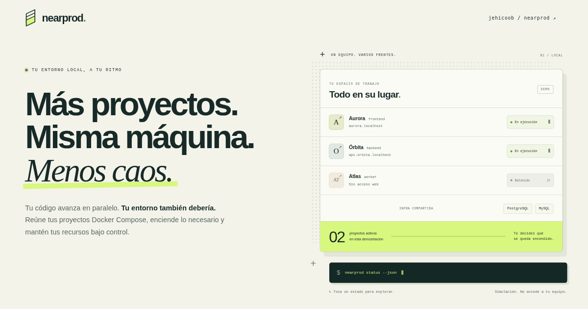
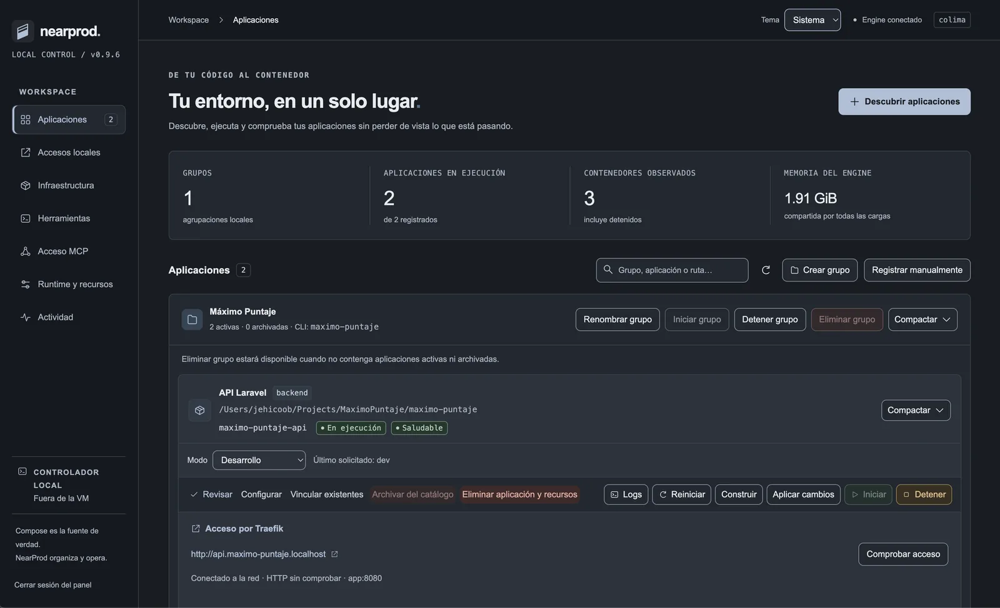
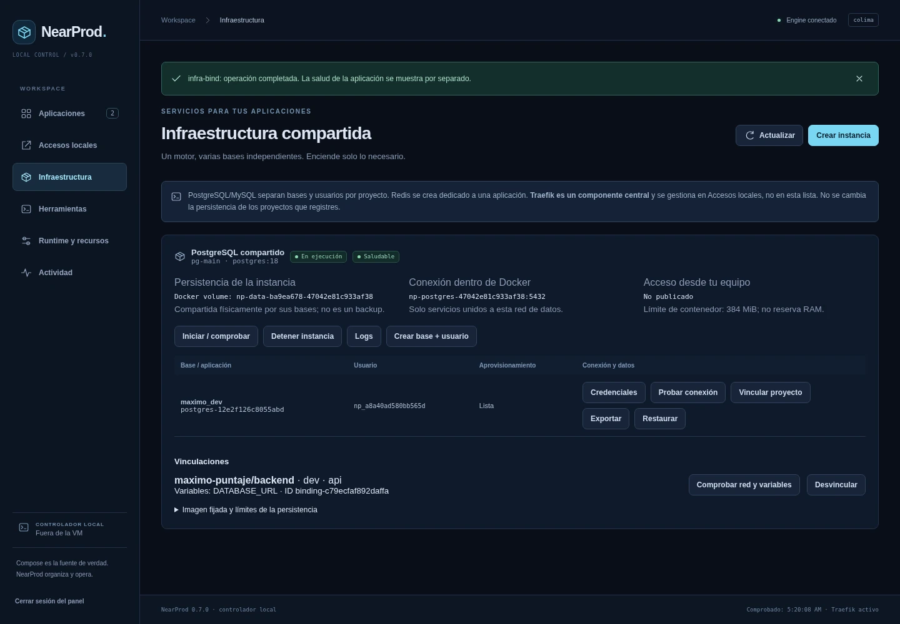
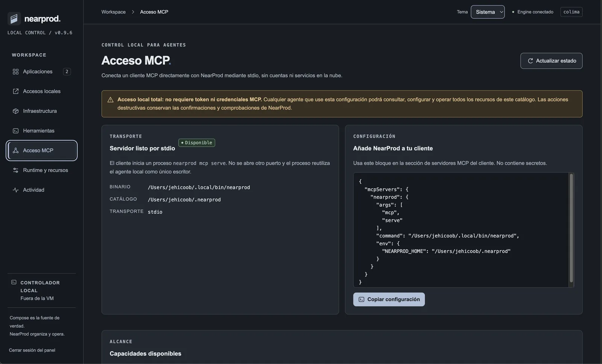
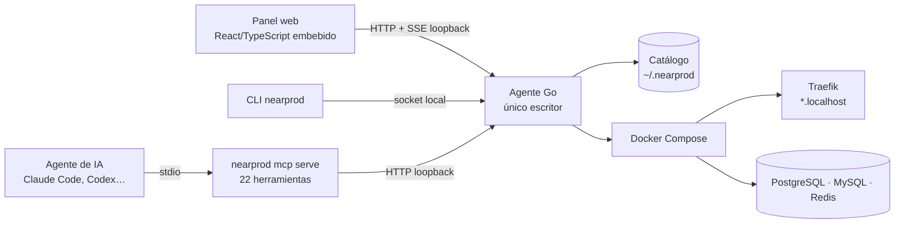

# NearProd

<p align="center">
  
</p>

<p align="center">
  <a href="https://github.com/jehicoob/nearprod/releases/latest"></a>
  <a href="https://github.com/jehicoob/nearprod/actions/workflows/ci.yml"></a>
  
  
  <a href="LICENSE"></a>
</p>

**Ejecuta tus aplicaciones Docker Compose en local como en producción y deja que tus agentes de IA las operen de forma segura.** NearProd reúne tus proyectos bajo URLs `proyecto.localhost` con Traefik, comparte PostgreSQL, MySQL y Redis entre ellos y expone todo por un panel web, un CLI y un servidor MCP. Es un único binario de Go, sin Node en tiempo de ejecución.

[Landing](https://nearprod.j6b.dev) · [Descargar](https://github.com/jehicoob/nearprod/releases/latest) · [Inicio rápido](docs/INICIO-RAPIDO.md) · [MCP](docs/MCP.md) · [Arquitectura](docs/SPEC-0.7.0.md)

<details>
<summary><strong>English summary</strong></summary>

NearProd is an open-source (MIT) local control plane for Docker Compose apps. It gives every project a production-like setup on your machine: `.localhost` URLs through Traefik, shared PostgreSQL/MySQL/Redis instances, health checks, and logs. Everything is shipped as a single Go binary with an embedded React/TypeScript dashboard.

It is built for **AI-assisted development**. A local **MCP server with 22 tools** (official Go SDK, stdio transport) lets coding agents such as Claude Code or Codex discover, configure, review, start, and debug applications. Every agent call goes through the same domain rules as the UI: read-only and destructive annotations, previews with fingerprints, explicit confirmations for data loss, and a single loopback agent as the only writer. Agents never get credentials or direct Docker/SQL access.

Releases are reproducible for macOS and Linux (amd64/arm64), with SHA-256 checksums and a verified self-update with rollback. CI runs `go vet`, the Go test suite with the race detector, and the UI type check on Ubuntu and macOS.
</details>

## IA: un entorno local que los agentes pueden operar

`nearprod mcp serve` levanta un servidor [MCP](https://modelcontextprotocol.io) por `stdio`, construido con el SDK oficial de Go. Un asistente de código puede operar tu entorno local con las mismas reglas que el panel:

- **22 herramientas MCP:** resumen del entorno, descubrimiento de proyectos Compose, configuración, revisión y aprobación, acciones de ciclo de vida, logs acotados, infraestructura y diagnóstico.
- **Guardrails en el dominio, no en el prompt:** cada herramienta declara si es de solo lectura o destructiva. Las operaciones peligrosas devuelven primero un *preview* con *fingerprint*, y purgar datos exige el ID escrito y `acknowledgeDataLoss`.
- **Un solo escritor:** MCP no toca el catálogo, Docker ni SQL de forma directa. Todo pasa por el agente local en loopback, que valida y serializa las operaciones. El cliente nunca recibe credenciales.
- **Pensado para agentes:** `nearprod_guide` explica el flujo inspeccionar → explicar → editar → validar → aplicar → verificar, y `nearprod_capabilities` publica cada operación con su esquema exacto.

```json
{
  "mcpServers": {
    "nearprod": { "command": "/ruta/a/nearprod", "args": ["mcp", "serve"] }
  }
}
```

El panel genera este bloque con la ruta real del binario en **Acceso MCP**. Detalles y límites en [docs/MCP.md](docs/MCP.md).

## Capturas

Panel de la versión 0.9.6.

| Aplicaciones | Infraestructura compartida |
|---|---|
|  |  |

<p align="center">
  
</p>

## Arquitectura



## Ingeniería destacada

- **Un binario, cero dependencias de ejecución:** el CLI, el agente y el panel compilado viven en el mismo ejecutable de Go.
- **Autoactualización verificada:** comprueba el *digest* de GitHub, `SHA256SUMS.txt`, el contenido del archive y la identidad del binario antes y después de instalar. Conserva la versión anterior para hacer *rollback* y reinicia el agente sin cortar la sesión de la UI.
- **Ciclo de vida seguro:** archivar, restaurar y purgar tienen *preview*, confirmación específica y revalidación. La migración del catálogo hace backup exacto y falla de forma cerrada.
- **Releases reproducibles:** toolchains exactos de Go y Node, cuatro plataformas, verificación del binario empaquetado y *draft* completo antes de publicar.
- **Calidad:** `go vet`, pruebas con *race detector* y *typecheck* de la UI en Ubuntu y macOS. `nearprod self-test` ejecuta pruebas de aceptación contra tu Docker real y limpia solo sus recursos.

**Stack:** Go 1.23 · MCP Go SDK · React + TypeScript · Docker Compose · Traefik · Colima · PostgreSQL · MySQL · Redis · GitHub Actions · GitHub Releases.

## Cómo funciona

Controlador local de aplicaciones Docker Compose, URLs `proyecto.localhost` por Traefik e infraestructura PostgreSQL/MySQL/Redis. El CLI y el agente están implementados en Go; el panel React/TypeScript compilado se incluye dentro del binario. **No inicia Node ni necesita npm para funcionar.**

La versión de este checkout está en [VERSION](VERSION). Los binarios publicados están en [GitHub Releases](https://github.com/jehicoob/nearprod/releases/latest); las pruebas ejecutadas y sus límites están en [PRUEBAS](docs/PRUEBAS.md).

> **Toolchains de distribución:** las releases se construyen con las versiones exactas de `.go-version` y `.node-version`; el pipeline rechaza otras versiones y un checkout con cambios sin guardar. Los binarios históricos documentados en la auditoría no son publicables. Ver [COMPILAR](docs/COMPILAR.md). No se incluye firma Developer ID ni notarización Apple.

El selector **Tema** ofrece **Sistema**, **Claro** y **Oscuro**, también en la pantalla de acceso. La elección se guarda en el navegador para esa dirección del panel; en Sistema sigue los cambios del sistema operativo. No cambia Docker ni el catálogo.

El panel permite **Eliminar aplicación y recursos** tanto en aplicaciones activas como archivadas: muestra qué se borrará, exige confirmar el ID y conserva el código. Si la limpieza falla, mantiene el registro para reintentar. Consulta el [alcance y los límites de la eliminación](docs/APPLICATION_DELETION.md).

Cada aplicación activa o archivada tiene un control **Compactar / Expandir**: oculta sus acciones y recursos mientras mantiene visibles el nombre, la ruta y el estado. Las tarjetas se pueden compactar de forma independiente. El encabezado de cada grupo también permite compactar todas sus aplicaciones; al expandirlo se conserva el estado de cada tarjeta.

Los controles reflejan el estado observado: **Iniciar** se deshabilita si la aplicación ya está en ejecución en el mismo modo; **Detener** requiere servicios en ejecución. **Aplicar cambios** actualiza la configuración y las variables con Compose; **Construir** solicita reconstruir imágenes y recrear servicios. Una configuración modificada vuelve a requerir revisión.

La salud se obtiene de los [healthchecks de Docker](https://docs.docker.com/reference/compose-file/services/#healthcheck). El panel distingue comprobaciones ausentes, cobertura incompleta y resultados de salud; estar en ejecución o responder por Traefik no sustituye estas pruebas. Cada proyecto define qué comprueba su healthcheck.

## Actualizar desde 0.6.1 sin registrar otra vez tus proyectos

No borres `~/.nearprod`, tus volúmenes ni carpetas de bases. Usa el mismo `NEARPROD_HOME` que antes; cambiarlo abre deliberadamente otro catálogo.

En el Mac M1, desde el archive descomprimido, confirma primero el binario que vas a instalar:

```bash
./nearprod --version
```

La UI ya está incluida; no hace falta Go ni Node para este paso. Después:

```bash
# 1. Cerrar el agente anterior, NO Colima ni tus contenedores.
nearprod agent stop

# 2. Examinar la migración. Esto no escribe ni ejecuta Docker.
./nearprod config migrate --dry-run

# 3. Instalar el ejecutable estable. No toca el catálogo.
./nearprod install --configure-shell
```

Abre otra terminal. Si el comando sigue apuntando a una instalación vieja, usa directamente `~/.local/bin/nearprod` en las siguientes instrucciones.

```bash
nearprod --version                  # muestra la versión instalada
nearprod config migrate --yes       # backup + migración; exige agente anterior cerrado
nearprod ui
```

Si `nearprod` no era reconocido antes de instalar, ejecuta `./nearprod agent stop`. `AGENT_OFFLINE` significa que ya está cerrado. **No ignores `AGENT_RUNNING`, errores de permisos o migración conflictiva.**

La primera apertura también puede realizar la migración. La secuencia explícita anterior permite ver primero el cambio. Las aplicaciones, grupos, nombres Compose, dominios, IDs de volúmenes, credenciales y vínculos se conservan. Hace falta una **nueva revisión/aprobación de la configuración** antes de iniciar con el nuevo controlador; eso no es volver a registrar.

## Instalación nueva

Descarga el archive de tu plataforma desde [la última release estable](https://github.com/jehicoob/nearprod/releases/latest), verifica su SHA-256 y descomprímelo siguiendo la [guía de instalación](docs/INSTALAR-BINARIO.md). Desde la carpeta extraída:

```bash
./nearprod install --configure-shell
# Terminal nueva:
nearprod ui
```

Hay binarios para macOS y Linux, ARM64 y AMD64; el autoarranque administrado es exclusivo de macOS. El CLI, HTTP y la instalación se validan en Ubuntu y macOS mediante CI; la reconexión del navegador se probó localmente en macOS ARM64. Si Gatekeeper impide abrir el binario, verifica origen y checksum y utiliza la autorización individual de macOS o compila localmente; no desactives Gatekeeper globalmente.

El instalador guarda `~/.local/bin/nearprod` y copias de versiones bajo `~/.local/share/nearprod/releases`. Hace backup de `.zshrc` al añadir su función/ruta; no sustituye aliases ajenos, Node ni gestores de paquetes. No utiliza `sudo`.

Para una instalación manual:

```bash
nearprod update --check
nearprod update
```

El segundo comando muestra la versión y solicita confirmación. Descarga desde la release pública oficial, verifica el digest de GitHub, `SHA256SUMS.txt`, el contenido del archive y la identidad del nuevo ejecutable antes y después de instalarlo. Conserva una copia anterior y limpia los temporales. Si el agente está activo y libre, lo reinicia con la nueva versión en el mismo puerto; las interfaces compatibles conservan su sesión y se recargan automáticamente. Si hay operaciones o Watch activos, rechaza la actualización sin reemplazar el ejecutable ni interrumpirlos. No detiene contenedores ni cambia sus datos. Las instalaciones Homebrew deben usar `brew upgrade nearprod`. Consulta los límites de versiones anteriores y recuperación en la [guía de actualización](docs/INSTALAR-BINARIO.md#actualizar-una-instalación-manual).

Las releases desde `0.9.1` conservan la reparación de compatibilidad con los actualizadores `0.8.0` y las instalaciones normales de `0.9.0`. No borres `~/.local/share/nearprod/installation.json` durante el cambio. Si tienes una copia manual `0.9.0` sin ese registro, descarga y verifica la última release estable antes de ejecutar `./nearprod install --configure-shell`. El reinicio automático se incorpora en `0.9.4`; la primera transición desde un actualizador anterior necesita cerrar y abrir el agente una vez. Consulta [MIGRACION](docs/MIGRACION.md) para el procedimiento y sus límites.

## Dónde permanece todo

```text
~/.nearprod/
├── config/
│   ├── catalog.json                # grupos, proyectos, URLs, preferencias, referencias
│   ├── migration.json              # journal de migraciones de schema
│   └── resources/<uid>/vault.json   # credenciales de NUEVAS instancias, archivo 0600
├── databases/                     # ubicación sugerida, SOLO para nuevas carpetas elegidas
│   ├── postgres/pg-main/data/
│   └── mysql/mysql-main/data/
├── backups/
│   ├── config/                    # metadata/credenciales, no archivos físicos de DB
│   └── databases/                 # exportaciones SQL manuales
├── infra/<uid>/                   # se conserva para instancias creadas en 0.6.x
├── proxy/                         # rutas/configuración del Traefik existente
├── catalog.json                   # marcador que impide que 0.6 escriba el catálogo migrado
└── agent.sock, agent.json, ...     # coordinación local, no documentos de proyecto
```

La carpeta de datos representa **la instancia del motor**, no una carpeta por base lógica SQL. Las instancias antiguas conservan sus rutas o volúmenes originales: la migración no mueve archivos de motores activos ni copia volúmenes Docker a macOS. Los volúmenes Docker siguen en la VM. No se modifica la persistencia de Compose importados.

```bash
nearprod config paths
nearprod config backup --yes
```

Ese backup es privado y contiene credenciales; no lo publiques. Tampoco sustituye un backup consistente de MySQL/PostgreSQL.

## Recorrido diario

1. **Herramientas:** detectar/conservar Docker CLI, Compose, Buildx, Colima. Homebrew macOS permite instalación/reparación confirmada. No se modifica Node.
2. **Runtime:** elegir el contexto local y el perfil Colima existente. El panel puede abrir con Engine detenido.
3. **Accesos locales:** activar un solo Traefik. Puerto 80 permite `http://tienda.localhost`; 8080 añade `:8080`. Los puertos internos web se configuran aparte.
4. **Descubrir aplicaciones:** seleccionar raíz, candidatos y grupo; elegir Compose/env/perfiles y URLs. Guardar no ejecuta nada.
5. **Revisar y aprobar → Iniciar:** estado, logs, URL y salud. El servidor HTTP debe escuchar en una interfaz alcanzable. NearProd no cambia CORS/HMR/APP_URL.
6. **Infraestructura:** crear instancia/base/usuario, vincular API o worker, revisar y volver a iniciar para aplicar. Las DB propias del proyecto se conservan.

## Acceso MCP local

En el panel, **Acceso MCP** muestra una configuración copiable con la ruta exacta del binario y el `NEARPROD_HOME` activo. El transporte es stdio:

```bash
nearprod mcp serve
```

No crea usuarios, perfiles, sesiones o tokens MCP ni abre otro puerto. El cliente obtiene acceso total a ese catálogo local y reutiliza el agente HTTP loopback como único escritor; las validaciones, ownership, previews, fingerprints y confirmaciones destructivas del dominio siguen vigentes. Consulta [MCP](docs/MCP.md) para el alcance y la configuración.

Para Laravel dirige la URL a Caddy/Nginx HTTP, no a PHP-FPM. Para Elixir/Phoenix, el proyecto necesita un Compose y su servidor/release/puerto/origen correctos. Los ejemplos del ZIP cubren esos recorridos de prueba; no convierten una configuración arbitraria en válida.

## Inicio al entrar en macOS

```bash
nearprod startup enable
nearprod startup status
nearprod startup disable
```

Solo inicia el agente, no el navegador, Colima, Traefik, bases o proyectos. Tras actualizar desde Node, ejecuta nuevamente `startup enable` para actualizar el plist a la ruta del binario nativo. No es arranque antes de iniciar sesión; no usa KeepAlive para resucitar un agente detenido intencionalmente. Ver [STARTUP](docs/STARTUP.md).

## Validación con tu Docker real

```bash
# macOS / Colima
nearprod self-test --yes --context colima
nearprod self-test --yes --context colima --infra-only --folder

# Linux / WSL2 con Docker nativo
nearprod self-test --yes --context default
```

Pruebas opt-in: crean imágenes/contenedores/redes/volúmenes y bases TEMPORALES, comprueban rutas, SQL, separación, persistencia y recuperación; limpian solo sus recursos identificados. No cambian tu catálogo, datos, DNS o Colima; imágenes/caché permanecen. Revisa el informe `nearprod-acceptance-*/result.json`. Código 77 es bloqueo, no aprobado. La modalidad completa ejecuta motores secuencialmente, pero no promete caber junto a todas tus aplicaciones en 2 GiB.

## Documentación

[Inicio rápido](docs/INICIO-RAPIDO.md) · [Migración y almacenamiento](docs/MIGRACION.md) · [Infraestructura](docs/INFRAESTRUCTURA.md) · [Ciclo de vida](docs/CICLO-DE-VIDA.md) · [MCP](docs/MCP.md) · [CLI](docs/CLI.md) · [Arquitectura/spec](docs/SPEC-0.7.0.md) · [Auditoría](docs/AUDITORIA-0.7.0.md) · [Pruebas](docs/PRUEBAS.md) · [Compilar](docs/COMPILAR.md)

No incluye TLS/DNS administrado, despliegue remoto, adopción automática de proxies externos, actualización mayor in situ de bases, borrado de datos, migración automática de DBs de proyectos ni soporte universal Compose `include`/`extends`. No garantiza ahorro de RAM de los contenedores: Go sustituye el controlador, no la VM Linux.

## Distribución desde GitHub y Homebrew

La preparación de releases, versionado, CI y tap personal se documenta en [docs/DISTRIBUCION.md](docs/DISTRIBUCION.md). Para descargar y ejecutar sin compilar, consulta [docs/INSTALAR-BINARIO.md](docs/INSTALAR-BINARIO.md). NearProd se distribuye bajo licencia MIT. El repositorio y sus releases son públicos; el tap de Homebrew todavía no está configurado.
